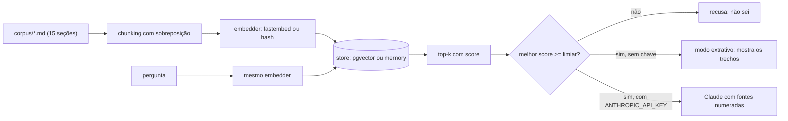

# rag-mini

> **Projeto de estudo.** Eu ainda não usei RAG em produção: este repositório é onde eu aprendi o
> ciclo completo (indexar, buscar, responder só com as fontes, medir) numa escala que cabe na cabeça.
> O corpus é fictício e os números abaixo são de um conjunto pequeno, medido por mim mesmo.

Um RAG pequeno em Python que responde perguntas sobre um manual de canteiro de obras, cita de onde tirou
cada trecho e **tenta recusar quando a resposta não está nas fontes**. A recusa é parcial: um limiar de
score barra só o que é totalmente fora de assunto (nas 3 perguntas sem resposta do eval, pegou 1 com o
`fastembed` e nenhuma com o `hash`), e o resto depende de uma regra no prompt que eu não testei contra a
API real. Detalhes em [Resultado](#resultado) e [Limitações](#limitações--o-que-ficou-de-fora).

Sem framework de
RAG: cada etapa é um arquivo curto que dá para ler de uma vez.

## Problema

Manuais e procedimentos são longos, e quem está na obra quer a resposta de uma pergunta, não o PDF
inteiro. Um LLM sozinho responde com segurança mesmo sem saber, e em segurança do trabalho isso é pior
que não responder. Eu queria um fluxo em que a resposta venha dos documentos, com a fonte à vista, e
em que "não sei" seja uma resposta aceita.

## Solução

1. **Ingestão** (`ingest.py`): lê `corpus/*.md`, divide cada seção em trechos de até 400 caracteres com
   150 de sobreposição, guarda o título da seção como metadado e gera um vetor por trecho.
2. **Busca** (`search.py`): vetor da pergunta contra os vetores dos trechos, similaridade de cosseno,
   top-k com a pontuação de cada um.
3. **Resposta** (`ask.py`): monta um prompt com as fontes numeradas `[1]`, `[2]`... e a regra "se não está
   nas fontes, diga que não sabe". Com `ANTHROPIC_API_KEY`, chama o Claude pelo SDK oficial. Sem a chave,
   imprime os trechos recuperados (modo extrativo). Se o melhor trecho tem score abaixo do limiar, recusa
   antes de gastar uma chamada.
4. **Avaliação** (`eval/`): 15 perguntas com a seção esperada e 3 perguntas sem resposta no corpus.

O índice fica em **Postgres com pgvector** (`--store pgvector`, o padrão) ou em **memória, Python puro**
(`--store memory`), para rodar testes sem Docker.

## Diagrama



## Stack

Python 3.12 · Postgres 17 + [pgvector](https://github.com/pgvector/pgvector) (imagem oficial
`pgvector/pgvector:pg17`) · [fastembed](https://github.com/qdrant/fastembed) com o modelo
`paraphrase-multilingual-MiniLM-L12-v2` (exportação ONNX otimizada, com pesos em float16; 384 dimensões, roda local em CPU, sem API) · SDK oficial
`anthropic` (opcional) · `psycopg` 3 · pytest · Docker Compose.

## Resultado

Tudo medido nesta máquina, com os comandos abaixo, sobre o corpus de 15 seções (46 trechos) e as 18
perguntas de `eval/questions.json`.

| Embedder | Comando | recall@3 | MRR |
|---|---|---|---|
| `hash` (lexical, sem modelo) | `python eval/run_eval.py --store memory --embedder hash` | **0,933** (14/15) | 0,761 |
| `fastembed` (MiniLM multilíngue) | `python eval/run_eval.py --store memory --embedder fastembed` | **0,800** (12/15) | 0,752 |

**Versões com que medi** (em 28/10/2026; os scores do modelo podem mudar com outras versões, e então o limiar
0,25 e a faixa 0,13 a 0,29 mais abaixo deixam de valer): Python 3.12.10 no Windows 10, `fastembed` 0.9.1,
`onnxruntime` 1.31.1, `tokenizers` 0.23.3, `numpy` 2.5.4, `psycopg` 3.3.6, `anthropic` 2.3.0 (só na execução
manual do `ask.py` contra um servidor HTTP falso; os testes usam um cliente falso e não importam o SDK), `pytest` 9.2.0. Modelo: o repositório `Qdrant/paraphrase-multilingual-MiniLM-L12-v2-onnx-Q`
(é o que o `fastembed` baixa para `sentence-transformers/paraphrase-multilingual-MiniLM-L12-v2`), revisão `faf4aa4`, arquivo
`model_optimized.onnx`. Banco: Postgres 17.11 com pgvector 0.8.7, imagem `pgvector/pgvector:pg17`
(`sha256:ac08538c6f8b`). O conjunto completo está em [`requirements.lock`](requirements.lock): instalei a
partir dele num ambiente novo e os números desta seção se repetiram idênticos. O `requirements.txt` tem só
limites mínimos de propósito, então uma instalação nova pode trazer versões diferentes.

- **recall@3**: em quantas das 15 perguntas respondíveis algum dos 3 primeiros trechos vem da seção
  esperada. **MRR**: média de 1/posição do primeiro trecho certo (olhando os 10 primeiros). Os dois são
  contados por trecho, não por seção.
- O resultado com `--store pgvector` (depois de `python ingest.py`) é idêntico ao de `memory`: conferi com
  `diff` na saída completa do eval, para os dois embedders.
- Onde cada um errou: `hash` perdeu a q12 (posição 4). `fastembed` perdeu a q05 (posição 7), a q08
  (posição 7) e a q14 (fora dos 10 primeiros). A q08 e a q14 envolvem sinônimos ("quadro de energia" no lugar
  de "quadro de distribuição"; "vergalhão" no lugar de "aço"). A q05 usa as mesmas palavras do texto
  ("embalagem rasgada") e mesmo assim ficou em 7º; não investiguei o porquê.

**Como ler esses números sem se enganar:**

- São só 15 perguntas: uma pergunta vale 6,7 pontos. A diferença entre 0,933 e 0,800 (2 perguntas)
  **não prova** que o `hash` é melhor que o modelo; prova que, neste corpus pequeno e nestas perguntas,
  a diferença é pequena.
- O corpus e as perguntas foram escritos na mesma sessão, por mim (ninguém
  de fora e nenhum manual real), então as perguntas reaproveitam as palavras do texto, o que favorece um
  embedder lexical. E o MiniLM é um modelo treinado para parafrasear, não para achar passagem a partir de
  pergunta, e corta o texto em 128 tokens.
- Passei por três configurações de chunking (500/100, 400/80, 400/150; motivo: o limite de 128 tokens
  do modelo e a sobreposição quase não existir com frases longas). Não varri parâmetros contra o eval.
  Rodei o eval com duas configurações alternativas só para ver a sensibilidade, com o `hash`:
  `--size 500 --overlap 100` dá recall@3 = 0,800 e MRR = 0,780; `--overlap 80` (tamanho 400) dá
  recall@3 = 0,933 e MRR = 0,828, melhor que o 0,761 do padrão. A escolha do 400/150 foi pela repetição
  de texto nas fronteiras (28 de 31), não pela métrica, e o `hash` teria ido melhor com overlap 80.

**Recusa por limiar** (3 perguntas sem resposta no corpus: `n01` capital da Austrália, `n02` salário de
mestre de obras, `n03` traço de concreto):

| Embedder | Limiar | Recusas corretas | Falsas recusas | Score da `n01` / `n02` / `n03` |
|---|---|---|---|---|
| `fastembed` | 0,25 | 1/3 | 0/15 | 0,12 / 0,48 / 0,57 |
| `hash` | 0,05 | 0/3 | 0/15 | 0,14 / 0,16 / 0,25 |

O limiar só pega o que é **totalmente** fora de assunto. `n02` e `n03` falam de obra e de concreto, e
pontuam mais alto que perguntas legítimas (a q08 tem top-1 de 0,42 com o `fastembed`). Com o `hash` nenhum
limiar separa as perguntas, então deixei quase desligado. No `fastembed`, qualquer valor entre 0,13 e 0,29
dá o mesmo resultado nas 18 perguntas; escolhi 0,25. **O limiar foi escolhido nas mesmas perguntas do
eval**, então o resultado dele é otimista. No modo extrativo isso não é problema (quem lê vê os trechos);
no modo com Claude, quem cobre `n02`/`n03` é a regra de recusa do prompt, que **eu não avaliei contra a
API real** (veja Limitações).

Outros números medidos: `pytest` passa 26 testes sem Docker (um 27º, o de pgvector, é pulado) e 27 com
o Postgres de pé (`RAG_TEST_PG=1 pytest`). Na primeira execução o `fastembed` baixa o modelo (cerca de 250 MB; levou menos de um
minuto aqui) e depois fica em cache fora do repositório.

## Como rodar

Sem chave, sem API paga. Precisa de Python 3.12+ para usar o `requirements.lock` (ele fixa o `numpy` 2.5.4,
que exige 3.12). Docker só para o caminho pgvector. O código não usa sintaxe mais nova que a do 3.10, mas só
rodei em 3.12; em outras versões os pacotes mudam e os números podem mudar.

```bash
python -m venv .venv
source .venv/bin/activate          # Windows: .venv\Scripts\activate
pip install -r requirements-dev.txt   # ou: pip install -r requirements.lock (as versões exatas das medições; exige Python 3.12+)
```

**Caminho rápido (sem Docker e sem baixar modelo).** Se quiser só este caminho, rode `pip install pytest` no
lugar do `requirements-dev.txt`:

```bash
pytest
python eval/run_eval.py --store memory --embedder hash
python search.py "Qual a altura do guarda-corpo do andaime?" --store memory --embedder hash
python ask.py "Em que profundidade a vala precisa de escoramento?" --store memory --embedder hash
```

**Caminho completo (modelo local + Postgres com pgvector):**

```bash
docker compose up -d --wait        # sobe o Postgres em 127.0.0.1:5433
python ingest.py                   # indexa o corpus (1ª vez: baixa o modelo, ~250 MB)
python search.py "Quantos sacos de cimento posso empilhar?" -k 3
python ask.py "Em que profundidade a vala precisa de escoramento?"
python eval/run_eval.py
RAG_TEST_PG=1 pytest               # Windows PowerShell: $env:RAG_TEST_PG=1; pytest
docker compose down -v             # desliga e apaga o volume
```

**Com o Claude (opcional):** defina a chave e rode o `ask.py` de novo. O modelo padrão está em
`rag/prompt.py` e pode ser trocado com `ANTHROPIC_MODEL`. Precisa do pacote `anthropic` (já está em
`requirements.txt`; no caminho rápido, rode `pip install anthropic`).

```bash
export ANTHROPIC_API_KEY=...       # PowerShell: $env:ANTHROPIC_API_KEY="..."
python ask.py "Qual a altura do guarda-corpo do andaime?"
```

Se `fastembed` não estiver instalado, `--embedder auto` (o padrão) cai no `hash` e avisa. Para escolher o
local do cache do modelo: variável `FASTEMBED_CACHE_PATH`. As variáveis aceitas estão em `.env.example`
(os scripts não leem `.env`; exporte no shell).

## Estrutura de pastas

```
rag-mini/
├── corpus/                 15 seções do manual fictício (um .md por seção, 1ª linha = título)
├── rag/
│   ├── chunking.py         leitura do corpus e divisão em trechos com sobreposição
│   ├── embedders.py        HashEmbedder (determinístico) e FastEmbedder (modelo local)
│   ├── stores.py           MemoryStore (Python puro) e PgVectorStore
│   ├── pipeline.py         argumentos comuns, ingestão, abertura do índice
│   └── prompt.py           prompt com fontes numeradas, recusa, chamada ao Claude
├── ingest.py               indexa o corpus
├── search.py               top-k com scores
├── ask.py                  resposta com fontes (Claude se houver chave; senão extrativo)
├── eval/
│   ├── questions.json      15 perguntas com seção esperada + 3 sem resposta no corpus
│   └── run_eval.py         recall@3, MRR e teste de recusa
├── tests/                  pytest (chunking, embedders, store, prompt, métrica do eval, eval, pgvector opcional)
├── docs/producao.md        "Como eu desenharia isso em produção" (notas, NÃO implementado)
├── docker-compose.yml      Postgres 17 + pgvector
├── requirements*.txt  requirements.lock  .env.example  pytest.ini  LICENSE  .gitignore  .gitattributes
```

## Decisões de projeto

- **Dois stores atrás da mesma interface** (`reset`, `add`, `search`). O `memory` deixa os testes rodarem
  em menos de um segundo, sem Docker. O custo: é uma varredura linear e não persiste (cada `search.py`
  reindexa). O `pgvector` é o caminho "de verdade"; com 46 trechos o índice HNSW não muda nada na prática,
  ele está lá para mostrar o `CREATE INDEX`. Os dois dão o mesmo resultado no eval.
- **Embedding local em vez de API.** Sem chave, sem custo e reprodutível por quem clonar. O custo:
  um modelo pequeno, de qualidade modesta (ver Resultado).
- **Embedder `hash` determinístico.** Existe para os testes e para rodar sem baixar nada: palavras e pares
  de palavras viram posições de um vetor de 512 dimensões (`crc32`), com um stemmer grosseiro. É lexical e
  **não serve para produção**; está aqui como baseline honesto, não como concorrente do modelo.
- **Título da seção entra no texto que vira vetor.** Trechos como "A tolerância é de 2 cm..." não dizem
  de que assunto são; o título ajuda a achá-los.
- **Chunking por frases, tamanho 400 e sobreposição 150 caracteres.** O limite de 128 tokens do modelo
  pediu trechos curtos. Frases são o menor bloco, então uma sobreposição de 80 não repetia nada na maioria
  das fronteiras; com 150, 28 das 31 fronteiras repetem a última frase (`python ingest.py --store memory --embedder hash -v`
  imprime essa contagem). O efeito colateral é que os trechos vizinhos voltam quase duplicados no top-3.
- **Recusa em duas camadas:** limiar de score antes da chamada (barato, só pega o fora de assunto) e regra
  no prompt (cobre o resto, mas depende do modelo). O prompt manda o modelo tratar o texto das fontes
  como dado, não como instrução. É só uma regra no prompt: não testei com um trecho que traga uma ordem
  embutida, e o caminho com o Claude não foi rodado contra a API real.
- **Modo extrativo quando não há chave.** O projeto roda e é testável de graça. Não gera frases, só
  mostra os trechos.
- **Reindexar tudo a cada `ingest.py`** (apaga e recria a tabela `rag_mini_chunks`): simples e repetível.
  Não escala; a alternativa está em `docs/producao.md`. Se o corpus estiver vazio ou o caminho de `--corpus`
  estiver errado, o `ingest.py` aborta antes de apagar a tabela. Como isso é destrutivo, a conexão vem de
  `RAG_DATABASE_URL`, e não de um `DATABASE_URL` genérico que você talvez já tenha no shell para outro
  projeto, e a tabela tem nome próprio.
- **Postgres em `127.0.0.1:5433`**, senha de desenvolvimento no compose e porta fora da 5432 para não
  brigar com um Postgres que você já tenha. Uso `127.0.0.1` e não `localhost`: no Windows o `localhost`
  tenta `::1` primeiro, o Docker só publica em IPv4 e a conexão travou até o timeout aqui.

## Limitações / o que ficou de fora

- **Escala de brinquedo:** 15 seções, cerca de 2.100 palavras, 18 perguntas escritas junto com o corpus (por mim).
  Limiar calibrado nas mesmas perguntas. Nada aqui diz como isso se comporta com documentos reais.
- **O caminho com Claude não foi testado contra a API real** (eu não usei chave nem gastei chamada).
  O que foi feito: testes unitários com um cliente falso, e uma execução do `ask.py` de verdade, com o SDK
  `anthropic` instalado, contra um servidor HTTP local que imita `/v1/messages` (conferi o corpo enviado:
  modelo, `system` com a regra de recusa, fontes numeradas; o script desse servidor falso não está no
  repositório). Se a recusa por prompt funciona em casos reais, não sei.
- **Só a busca é avaliada**, não a qualidade da resposta gerada (fidelidade, citação certa).
- A recusa por limiar não pega perguntas parecidas com o assunto do corpus (`n02`, `n03`).
- Sem busca híbrida (BM25), sem reranking, sem remoção de trechos quase duplicados, sem permissões por
  usuário, sem reingestão incremental. O que eu faria está em [docs/producao.md](docs/producao.md), marcado
  como **não implementado**.
- Sem interface web nem API HTTP: só linha de comando.
- O modelo padrão do Claude em `rag/prompt.py` é uma escolha minha; confira se ele existe na sua conta.

## Licença

MIT, veja [LICENSE](LICENSE). Copyright (c) 2026 Rafael M. da Silva Santos. O corpus é texto fictício
escrito para este estudo e não substitui normas regulamentadoras nem projeto de segurança real.
