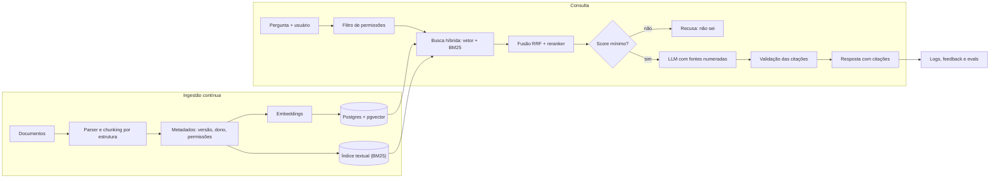

# Como eu desenharia isso em produção

> **Nada do que descrevo como "em produção" está implementado.** Os trechos marcados "hoje" ou "já faço" descrevem só o que este repositório já faz. São notas de projeto: o que eu pesquisei e o que faria,
> em ordem de prioridade. Eu nunca operei um RAG em produção. O que existe de verdade neste
> repositório está no [README](../README.md); aqui é o "e se fosse para valer".

## Diagrama (desenho proposto, não implementado)

## 1. Chunking

- **Hoje (implementado):** frases agrupadas até 400 caracteres, 150 de sobreposição, título da seção
  colado no texto que vira vetor. Simples e previsível, mas cego à estrutura.
- **Em produção:** cortar por estrutura (títulos, listas, tabelas), não por caracteres. Guardar o
  trecho pequeno para achar e o trecho "pai" (a seção inteira) para mostrar ao modelo
  (*small-to-big*). Tabelas e listas de passos não podem ser cortadas no meio.
- O tamanho certo não se adivinha: eu varreria 3 ou 4 tamanhos e escolheria pelo recall do eval (neste repositório não fiz essa varredura).
- Cada trecho carrega metadados: documento, versão, data, dono, página, permissões.
- PDFs escaneados pedem OCR antes de tudo, e o OCR precisa de checagem humana por amostragem.

## 2. Busca híbrida (BM25 + vetor)

Vetor acha sentido ("vergalhão" ~ "barras de aço"); BM25 acha o termo exato (siglas, números, nomes de
norma, códigos). Nenhum dos dois basta sozinho. O desenho: rodar os dois, juntar com
*Reciprocal Rank Fusion* (`score = Σ 1 / (60 + posição)`), que dispensa normalizar scores de escalas
diferentes. No Postgres dá para começar com `tsvector` (busca textual nativa) ao lado do pgvector,
sem subir outro serviço. Atenção: `tsvector`/`ts_rank` é busca textual, não BM25 de verdade; para
BM25 real, usar uma extensão como pg_search (ParadeDB) ou OpenSearch/Elasticsearch.

## 3. Reranking

Buscar largo (top 30 a 50) e reordenar com um *cross-encoder* (modelo que lê pergunta e trecho
juntos) antes de mandar só os 3 a 5 melhores ao LLM. Custa latência (não medi aqui) e
tem de ser medido: só entra se subir o recall@3 do eval o bastante para pagar a conta.

Trechos vizinhos quase duplicados (efeito da sobreposição) voltam juntos no top-k e gastam o espaço do prompt: colapsar/mesclar trechos adjacentes da mesma seção, ou diversificar com MMR, antes de montar o prompt. Não implementado.

## 4. Citações

- Trechos numerados no prompt (já faço isso) e resposta no formato `[n]`.
- **Validar no código:** todo `[n]` citado precisa existir na lista enviada; resposta com afirmação
  sem citação é rejeitada ou marcada.
- Mostrar ao usuário o trecho original e o link para o documento, não só o número.
- A API da Anthropic também tem um recurso nativo de citações para blocos de documento; avaliar se
  compensa frente ao formato próprio (depende de como os documentos são entregues).

## 5. Evals

- O eval deste repositório tem poucas perguntas, escritas junto com o corpus (por mim), e o limiar de
  recusa foi calibrado nas mesmas perguntas. Serve para mostrar o método, não para prometer qualidade.
- Em produção: 100+ perguntas reais (de logs e de quem usa), com a fonte esperada marcada por quem
  conhece o assunto. Separadas em conjunto de **calibração** (ajusta limiar) e de **teste** (só mede).
- Duas camadas: busca (recall@k, MRR) e resposta (fidelidade às fontes, recusa certa). Para a
  resposta, LLM como juiz **com** amostra revisada por humano, para saber se o juiz é confiável.
- Roda no CI a cada mudança de modelo de embedding, chunking, prompt ou modelo de geração. A
  regra: ninguém troca nada "porque parece melhor".

## 6. Guardrails

- Limiar de score antes de chamar o modelo (já faço) **e** regra de recusa no prompt (já faço). Os
  dois falham em casos diferentes: ver "Limitações" no README, a pergunta fora do corpus mas
  parecida com o tema passa do limiar.
- **Injeção de prompt vinda dos documentos:** o texto recuperado deve ser tratado como dado, não
  instrução (hoje só há uma regra no prompt, sem teste com ordem embutida). Delimitar, avisar o modelo, e **não dar ferramentas** (escrita, e-mail, busca na web) a um prompt que lê
  texto de terceiros sem uma camada de confirmação.
- Dados pessoais: mascarar na ingestão o que não precisa estar no índice.
- Limites: tamanho da pergunta, número de perguntas por usuário, tamanho da resposta.

## 7. Reingestão e frescor

- Hash do conteúdo de cada documento: só reindexa o que mudou (hoje o `ingest.py` apaga e refaz tudo).
- Documento removido ou substituído sai do índice (marca de exclusão e limpeza); trecho sem dono
  é bug, não "sobra".
- Disparo por evento (documento publicado) mais uma varredura noturna de conferência.
- Troca do modelo de embedding = novo índice ao lado do antigo, comparação pelo eval, troca
  atômica e só depois apagar o velho (as dimensões mudam, não dá para misturar).
- Mostrar a data/versão do documento junto da resposta: o usuário precisa saber o quanto confiar.

## 8. Custo

Custo por pergunta ≈ embedding da pergunta (desprezível) + tokens de entrada (prompt fixo +
`k` × tamanho do trecho) + tokens de saída. Não vou inventar preço aqui: o cálculo é
o preço por milhão de tokens do modelo escolhido × os tokens medidos no campo `usage`
de cada resposta. Alavancas, em ordem: mandar menos trechos (reranking permite), cache de prompt para
a parte fixa, cache de resposta para perguntas repetidas, modelo menor para etapas simples
(reescrever a pergunta, classificar se está no escopo). Embeddings se pagam uma vez por trecho,
por isso a reingestão incremental importa.

## 9. Permissões por usuário

Regra de ouro: **o filtro acontece antes do modelo**, nunca "peça ao modelo para não revelar".

- Cada trecho guarda quem pode lê-lo (obra, grupo, nível).
- A consulta já entra com o escopo do usuário (`WHERE obra_id = ANY(:obras_do_usuario)`), tanto no
  vetor quanto no BM25. O que o usuário não pode ver nunca chega ao prompt.
- Cache de respostas separado por escopo (senão uma resposta de quem pode vaza para quem não pode).
- Log de auditoria: quem perguntou, quais trechos foram usados.

## 10. Operação

- Cada pergunta registrada com os trechos, scores, tokens e latência.
- Polegar para cima/baixo na resposta; fila das perguntas recusadas, que viram conteúdo novo ou
  casos novos para o eval.
- Alerta quando a taxa de recusa ou o score médio muda de repente (sinal de documento quebrado
  na ingestão).
